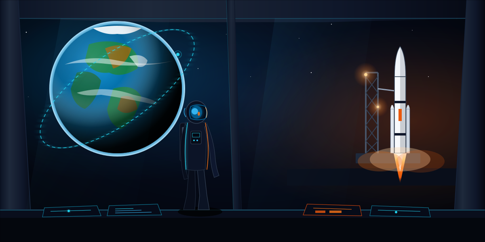
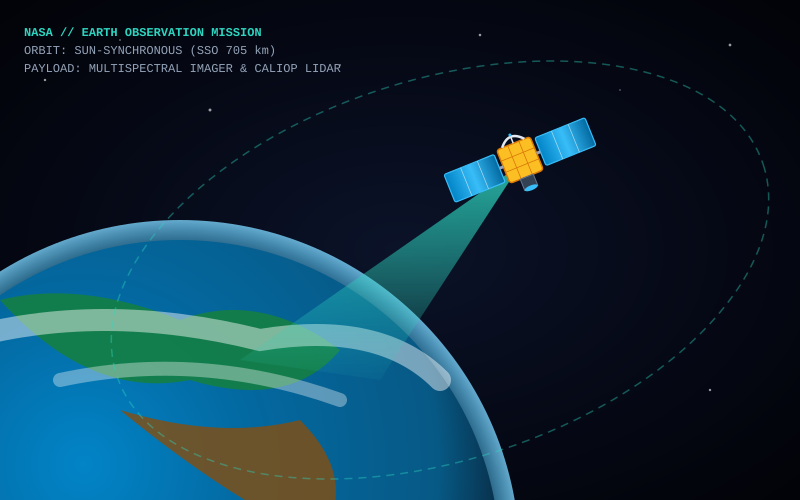
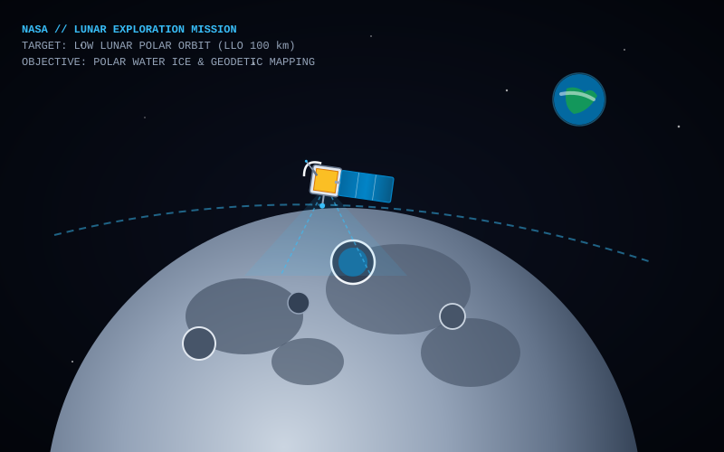
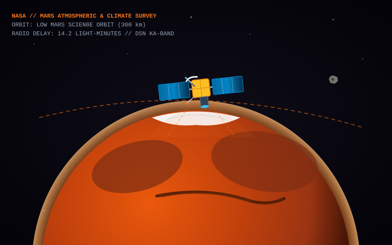
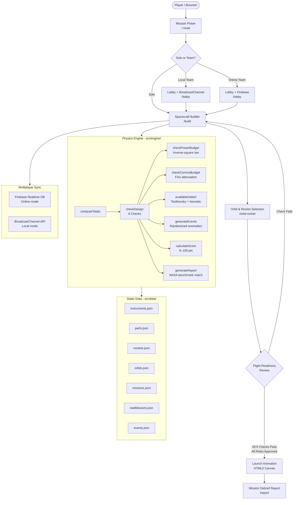

# CosmoCraft – Space Mission Design Simulator

> **Design the mission. Engineer the spacecraft. Explore beyond Earth.**

CosmoCraft is an interactive, physics-grounded web application built for the **NASA Space Apps Challenge 2026**. Players take on specialist roles inside a real NASA-style flight operations team to design, engineer, validate, and launch a scientifically credible space mission to Earth orbit, the Moon, or Mars — all within authentic engineering and budgetary constraints.

[](#)
[](#)
[](https://www.spaceappschallenge.org/)
[](#o-license)

| | |
|---|---|
| **Live App** | _[TODO: add deployed URL]_ |
| **Full Walkthrough Video** | _[TODO: add walkthrough video URL]_ |
| **Official Submission Demo** | _[TODO: add NASA Space Apps submission demo URL]_ |
| **GitHub Repository** | https://github.com/Div70-07/space_mission_game |

---

## Table of Contents

1. [Project Overview](#b-project-overview)
2. [The Experience](#c-the-experience)
3. [Key Features](#d-key-features)
4. [Screenshots](#e-screenshots-and-demo)
5. [NASA Data and Scientific Foundation](#f-nasa-data-and-scientific-foundation)
6. [How the Simulation Works](#g-how-the-simulation-works)
7. [Technology Stack](#h-technology-stack)
8. [System Architecture](#i-system-architecture)
9. [Installation and Local Setup](#j-installation-and-local-setup)
10. [Project Structure](#k-project-structure)
11. [Team and Contributions](#l-team-and-contributions)
12. [Limitations and Future Scope](#m-limitations-and-future-scope)
13. [Credits and Acknowledgements](#n-credits-and-acknowledgements)
14. [License](#o-license)

---

## B. Project Overview

### What is CosmoCraft?

Real space exploration is not done by one person. It requires mission planners who set objectives and budgets, systems engineers who balance mass and power, payload scientists who curate the instrument suite, and telecommunications officers who keep the data flowing back to Earth. CosmoCraft puts you and up to three colleagues in those exact seats.

The game presents players with an authentic engineering problem: design a spacecraft that can reach a chosen destination, survive for the required mission lifetime, produce meaningful science, and transmit it back — without breaking the budget or exceeding the rocket's lift capacity. Every decision has a measurable consequence expressed in real aerospace units.

### The Problem

Spacecraft systems engineering involves deeply interconnected trade-offs that are difficult to teach in the abstract. Adding a heavier instrument draws more power, generates more data, and demands a larger antenna and a more capable launch vehicle — all of which cost more money. Understanding *why* these trade-offs matter requires experiencing them, not just reading about them.

### The Solution

CosmoCraft makes these trade-offs tangible through a live dashboard of six mission resources — mass, power, budget, science data rate, telemetry downlink, and mission lifetime — that update in real time as players configure their spacecraft. Poor decisions result in failed launch readiness checks with specific, educational diagnostic messages; good decisions unlock a full multi-phase launch animation and a scored mission report.

### Intended Audience

Students, educators, space enthusiasts, and aspiring aerospace engineers who want to understand how NASA's mission formulation and systems engineering principles actually work.

---

## C. The Experience

### 1. Mission Selection
Players open the Mission Catalog and choose from three real-world–inspired missions at increasing difficulty:

| Level | Mission | Destination | Orbit | Budget |
|-------|---------|-------------|-------|--------|
| 1 – Beginner | Earth Climate & Terrestrial Observer | Earth | Sun-Synchronous (705 km) | \$180M |
| 2 – Intermediate | Lunar Polar Prospector & Water Ice Explorer | Moon | Low Lunar Orbit (100 km) | \$260M |
| 3 – Advanced | Mars Atmospheric Evolution & Climate Surveyor | Mars | Low Mars Science Orbit (300 km) | \$420M |

Each mission specifies a hard budget cap, minimum mission lifetime, minimum science discovery threshold, and a list of scientifically appropriate instruments.

### 2. Solo and Team Modes
- **Solo Architect** – one player controls all four subsystem workstations.
- **Local Team Mode** – up to four players share a device using a rotating "pass-the-laptop" workflow. Synchronized across browser tabs via the Web `BroadcastChannel` API.
- **Online Team Mode** – up to four remote players collaborate in real time using a Firebase Realtime Database room, identified by a 4-letter room code (e.g. `XK9P`).

### 3. Four Specialist Roles

| Role | Badge | Owns |
|------|-------|------|
| **Mission Planner** | `MISSION ARCH` | Mission destination, orbital trajectory, operational lifetime, overall budget |
| **Systems Engineer** | `POWER & BUS` | Power generation (solar arrays / RTG), spacecraft structure, launch vehicle, propellant load |
| **Science Lead** | `PAYLOAD` | Scientific instrument selection, science yield and data generation rate |
| **Telecommunications Officer** | `TELEMETRY` | Antenna selection, telemetry downlink bandwidth, ground link budget |

In team modes, each role exclusively controls its own subsystem workstation. Attempting to modify another specialist's panel displays a **"Subsystem Locked by Team Access Policy"** banner.

### 4. Spacecraft Engineering Workstation (`/build`)
Players assemble their spacecraft by selecting instruments, power systems, antennas, structural frames, and propellant. A live telemetry HUD shows six resource bars updating in real time.

### 5. The Six Mission Resources
Every component selection affects one or more of these six interconnected engineering constraints:

| Resource | Unit | What It Governs |
|----------|------|-----------------|
| Spacecraft Mass | kg | Structural dry mass + instruments + fuel vs. rocket payload capacity |
| Power Balance | W | Solar array / RTG generation (adjusted for distance from Sun) vs. payload draw |
| Financial Budget | \$M USD | Total mission cost vs. agency budget cap |
| Science Data Rate | MB/day | Cumulative observational data produced by payload instruments |
| Telemetry Downlink | MB/day | Antenna bandwidth vs. instrument data rate (prevents recorder overflow) |
| Mission Lifetime | Months | Component operational endurance vs. required mission baseline |

### 6. Orbit and Launch Vehicle Selection (`/orbit-rocket`)
Players choose a target orbit and commercial or government launch vehicle, then set the propellant load with a slider. The engine verifies that the spacecraft's wet mass does not exceed the rocket's payload capacity to the selected orbit, and that the available delta-V satisfies the orbital insertion requirement.

### 7. Flight Readiness Review and Sign-offs
Before launch is authorized, the engine runs eight independent engineering checks:

1. Launch mass vs. rocket payload capacity
2. Power generation vs. instrument draw
3. Total cost vs. mission budget
4. At least one science instrument selected
5. Telemetry downlink vs. instrument data rate
6. Mission lifetime vs. mission requirement
7. Launch vehicle selected and feasible
8. Orbit selected and delta-V margin satisfied

In team modes, **all active specialists must independently approve** the design before the launch sequencer starts. Any design modification resets all approvals.

### 8. Mission Launch Animation (`/orbit-rocket → MissionScene`)
A multi-phase canvas animation walks players through:
- Atmospheric ascent from the launch pad with gravity-turn trajectory
- Transonic Max-Q regime with vapor cone effect
- Main Engine Cutoff (MECO) and payload fairing separation
- Upper-stage ignition and deep-space cruise
- Orbital insertion and science operations

A live telemetry HUD overlaid on the canvas displays real-time altitude, velocity, downrange distance, and flight status codes.

### 9. Mission Report and Debrief (`/report`)
After launch, the engine generates a scored mission report covering:
- Overall flight score (0–100 pts), broken down across science yield, budget efficiency, technical safety margins, and teamwork bonus
- Random in-flight events (solar storms, DSN dropouts, instrument anomalies, subsurface discoveries)
- Specific engineering diagnostic messages explaining every passed or failed check
- A comparative benchmark against a real NASA mission matched by orbital destination

### 10. Tutorial Academy (`/tutorial`)
A six-step interactive guide walks new players through every phase of the game, tailored to each specialist role with aerospace context, pro tips, and links to in-game concepts.

---

## D. Key Features

- **Interactive mission design** across three destinations and six orbit types
- **Role-based multiplayer** with hardware-enforced subsystem access control
- **Real-time collaborative design** via Firebase Realtime Database (online) or BroadcastChannel API (local/offline)
- **Physics-informed engineering checks** — mass budget, power budget (with inverse-square solar law at Mars), delta-V validation (Tsiolkovsky equation for onboard propulsion), and Friis-inspired deep-space communications attenuation
- **10 NASA-referenced scientific instruments** with verified mass, power, and data specifications
- **5 launch vehicles** with per-orbit payload capacity data from official user guides
- **6 orbit types** with GMAT-referenced delta-V benchmarks
- **Custom multi-phase HTML5 Canvas 2D launch animation** — no video files, fully real-time rendered
- **7 randomized in-flight events** including solar flares, DSN dropouts, and scientific discoveries
- **NASA historical mission benchmarking** in every debrief report
- **Tutorial Academy** with role-specific guidance and aerospace engineering context
- **Responsive layout** supporting desktop and mobile viewports
- **Zero-network fallback** — the full game runs offline in solo or local team mode without Firebase

---

## E. Screenshots and Demo

> **Note to team:** Replace the placeholder paths below with actual screenshots once captured. Recommended capture resolution: 1920 × 1080 at 100% zoom.

### Mission Control – Landing Screen


### Mission Selection Catalog
> _[TODO: screenshot — `/` route showing the three mission cards]_

### Spacecraft Assembly Workstation
> _[TODO: screenshot — `/build` with the telemetry HUD and role tabs visible]_

### Engineering Dashboard (Resource Bars)
> _[TODO: screenshot — resource bars with a power deficit or comms bottleneck flagged red]_

### Orbit & Rocket Selection
> _[TODO: screenshot — `/orbit-rocket` showing orbit cards, rocket list, delta-V readout, and fuel slider]_

### Flight Readiness Review
> _[TODO: screenshot — the 8-check approval gate with all-green pass state]_

### Mission Launch Animation
> _[TODO: screenshot — canvas mid-flight with Max-Q vapor cone and telemetry HUD overlay]_

### Mission Debrief Report
> _[TODO: screenshot — `/report` showing score breakdown, in-flight events, and NASA mission comparison]_

### Tutorial Academy
> _[TODO: screenshot — `/tutorial` showing a step card with role focus and pro tip]_

### Mission Reference Images

| Earth Observer | Lunar Prospector | Mars Surveyor |
|:-:|:-:|:-:|
|  |  |  |

---

## F. NASA Data and Scientific Foundation

CosmoCraft is an educational simulator. All instrument specifications, orbital parameters, delta-V benchmarks, and mission references are **preloaded NASA-informed reference data** derived from verified public NASA technical documentation and mission reports. The application does not connect to any live NASA data APIs and is not an official NASA product.

---

### 1. Scientific Instruments

The 10 instruments in `src/data/instruments.json` have mass, power, and data-generation specifications drawn from published NASA instrument documentation:

| Instrument (In-Game Name) | NASA Reference Mission / Instrument |
|--------------------------|-------------------------------------|
| High-Resolution Optical Imager | HiRISE – Mars Reconnaissance Orbiter, University of Arizona / JPL |
| Imaging Infrared Spectrometer | CRISM – Mars Reconnaissance Orbiter, Johns Hopkins APL |
| Synthetic Aperture Radar & Altimeter | Magellan / Cassini RADAR / NASA SRTM |
| Triaxial Fluxgate Magnetometer & Plasma Wave Sensor | MAVEN Magnetometer, NASA GSFC / Voyager |
| Multispectral Thermal Infrared Radiometer | Diviner – Lunar Reconnaissance Orbiter, UCLA / JPL |
| Epithermal Neutron & Gamma-Ray Detector | LEND – Lunar Reconnaissance Orbiter / Lunar Prospector |
| Atmospheric Backscatter LIDAR | CALIOP – CALIPSO, NASA Langley Research Center |
| Imaging Ultraviolet Spectrograph | IUVS – MAVEN, LASP CU Boulder / New Horizons Alice |
| Shallow Subsurface Sounding Radar | SHARAD – Mars Reconnaissance Orbiter, NASA / ASI |
| Cosmic & Interplanetary Dust Analyzer | CDA – Cassini, NASA / ESA / Max Planck Institute |

The simulation enforces that only contextually appropriate instruments are selectable for each mission (e.g., the UV spectrograph is restricted to the Mars mission).

---

### 2. Spacecraft Components and Systems

Spacecraft bus components in `src/data/parts.json` reference the following:

| Component | NASA Reference |
|-----------|---------------|
| Standard Deployable Solar Array (300 W) | NASA Small Spacecraft Technology / Spectrolab Triple Junction PV |
| UltraFlex High-Efficiency Solar Array (750 W) | NASA InSight / Orion UltraFlex Solar Array Technology |
| MMRTG (125 W) | NASA Radioisotope Power Systems, Curiosity & Perseverance MMRTG |
| Next-Gen RTG (300 W) | NASA Next-Gen Radioisotope Thermoelectric Generator Project |
| Low-Gain S-Band Omni Antenna | NASA JPL SmallSat S-Band Communications Specification |
| Medium-Gain X-Band Horn Antenna | NASA Deep Space Network Compatible MGA Specification |
| High-Gain Parabolic Reflector (X-Band) | NASA LRO / MRO Cassegrain High-Gain Telemetry Subsystem |
| Deep Space Optical / Ka-Band Terminal | NASA Psyche Deep Space Optical Communications (DSOC) |
| Composite Honeycomb Primary Structure | NASA Systems Engineering Handbook, Spacecraft Bus Architecture |

---

### 3. Orbital Mechanics and Scientific Principles

**Supported Orbits (from `src/data/orbits.json`):**

| Orbit | Altitude | Notes |
|-------|----------|-------|
| Low Earth Orbit (LEO) | 400 km | 51.6° inclination, 92-min period |
| Sun-Synchronous Polar Orbit (SSO) | 705 km | 98.2° inclination, optimal for Earth imaging |
| Geostationary Transfer Orbit (GTO) | 250 km × 35,786 km | Gateway trajectory |
| Geostationary Earth Orbit (GEO) | 35,786 km | Fixed-longitude continuous coverage |
| Low Lunar Orbit (LLO) | 100 km polar | Polar access to permanently shadowed craters |
| Low Mars Science Orbit | 300 km | Sun-synchronous around Mars |

**Physics Models implemented in the engine (`src/engine/`):**

- **Delta-V benchmarks** (`deltaV.ts`): Reference values derived from NASA GMAT (General Mission Analysis Tool) for each orbit type (LEO: 9.4 km/s, SSO: 9.8, GTO: 11.2, GEO: 11.8, Moon: 13.8, Mars: 15.2 km/s).
- **Onboard propulsion** (`deltaV.ts`): Tsiolkovsky rocket equation with Isp = 310 s (monopropellant hydrazine). Documented in code as a simplified game approximation.
- **Solar power at Mars** (`power.ts`): Inverse-square law: Mars is 1.524 AU from the Sun → solar irradiance factor = 1 / 1.524² ≈ 0.43 (43% of Earth intensity). RTGs are unaffected.
- **Deep-space communications attenuation** (`comms.ts`): A 30% downlink penalty (attenuation factor 0.70) is applied for Mars missions and high-altitude orbits (> 100,000 km), inspired by the Friis free-space path loss model and Deep Space Network scheduling constraints. Documented as a game approximation.

> **Important:** The delta-V delivery model for launch vehicles is a simplified game heuristic (`14.0 × √massRatio`), not a full launch vehicle propulsion simulation. This is explicitly documented in the source code.

---

### 4. Launch Vehicles

Payload capacities in `src/data/rockets.json` are drawn from published launch vehicle user guides:

| Vehicle | Operator | Source | LEO Capacity |
|---------|----------|--------|-------------|
| Falcon 9 Block 5 | SpaceX | SpaceX Payload User's Guide, Rev 2 (2021) | 22,800 kg |
| Electron | Rocket Lab | Electron Payload User's Guide v6.5 (2020) | 300 kg |
| Atlas V 551 | United Launch Alliance | Atlas V LSUG Rev 11 | 18,850 kg |
| Vulcan Centaur VC6 | United Launch Alliance | Vulcan LSUG (2023) | 27,200 kg |
| Space Launch System (SLS Block 1) | NASA | SLS Mission Planner's Guide (ESD 30000) | 95,000 kg |

---

### 5. Real Space Missions

Five real NASA missions appear in `src/data/realMissions.json` and are presented to players in the mission debrief report as historical benchmarks matched to their orbital destination:

| Mission | Agency | Role in CosmoCraft |
|---------|--------|--------------------|
| **Landsat 9** | NASA / USGS | Earth SSO benchmark (vegetation, climate, land-use imagery) |
| **Lunar Reconnaissance Orbiter (LRO)** | NASA | Lunar polar benchmark (surface mapping, water ice, Artemis sites) |
| **Mars Reconnaissance Orbiter (MRO)** | NASA | Mars orbit benchmark (HiRISE imaging, SHARAD subsurface sounding) |
| **MAVEN** | NASA | Mars atmospheric benchmark (solar wind stripping, ion escape) |
| **Terra EOS AM-1** | NASA | Earth climate benchmark (aerosol depth, vegetation, energy balance) |

---

## G. How the Simulation Works

### Design → Constraint Chain

Every component a player selects modifies one or more of the six tracked resources. The table below shows representative trade-offs:

| Player Decision | Effect |
|----------------|--------|
| Add HiRISE-class imager | +65 kg mass, +60 W draw, +800 MB/day data, +90 pts science |
| Add UltraFlex solar array (750 W) | +80 kg mass, +750 W generation |
| Choose Mars orbit with solar panels | Solar generation reduced to 43% (inverse-square law) — may require RTG |
| Add high-gain parabolic dish (X-band) | +35 kg mass, +50 W draw, +1,000 MB/day downlink capacity |
| Add Mars-bound deep-space optical terminal | +55 kg, +85 W, +2,500 MB/day raw capacity, but attenuated by ×0.70 |
| Add 200 kg of propellant fuel | Increases wet mass → reduces payload margin → may fail launch check |

### Eight Engineering Checks (All Must Pass for Launch)

The `checkDesign` engine function validates:
1. **Mass** – wet spacecraft mass ≤ rocket's payload capacity to the selected orbit
2. **Power** – power generation (adjusted for orbital distance) ≥ total instrument + antenna draw
3. **Budget** – total component cost ≤ mission budget cap
4. **Science** – at least one instrument selected
5. **Comms** – effective downlink (after attenuation) ≥ daily science data production
6. **Lifetime** – player-selected mission duration ≥ mission minimum
7. **Launch** – rocket selected and mass check passed
8. **Orbit** – orbit selected and available delta-V ≥ required delta-V

Failure messages are specific and educational: *"Mars Solar Deficit (1/r² law): Sunlight is only 43% of Earth intensity. Panels produce 322W for a 440W load."*

### Scoring (0–100 pts)

| Component | Max |
|-----------|-----|
| Science yield relative to mission minimum | 45 pts |
| Budget efficiency (savings vs. cap) | 25 pts |
| Technical safety margins (power headroom, comms headroom) | 20 pts |
| Teamwork bonus (all 4 roles approved) | 10 pts |

### In-Flight Events

After launch, the engine draws from seven randomized events including coronal mass ejections (solar array degradation), DSN ground station dropouts, cryocooler thermal anomalies, and subsurface water-ice discoveries. All events include realistic impact descriptions drawn from actual mission anomaly language.

> CosmoCraft is an **educational simulation**. All physics models involve deliberate simplifications for accessibility and game balance. Scientific approximations are explicitly documented in source code comments.

---

## H. Technology Stack

### Frontend
| Technology | Version | Purpose |
|-----------|---------|---------|
| React | 19.x | Reactive UI framework |
| TypeScript | ~7.0 | Strongly-typed application code |
| Vite | 8.x | Build tooling and dev server |
| Tailwind CSS | 4.x | Utility-first responsive styling |
| Zustand | 5.x | Lightweight global state management (design store + team store) |
| React Router DOM | 7.x | Client-side routing |
| HTML5 Canvas 2D | Browser API | Custom launch animation and orbit visualization |

### Backend / Real-Time Sync
| Technology | Purpose |
|-----------|---------|
| Firebase Realtime Database | Online multiplayer room state, real-time design synchronization |
| Firebase Anonymous Auth | Secure, identity-based database access rules |
| Browser `BroadcastChannel` API | Local same-device multiplayer sync (zero-network) |
| `localStorage` | Local room state persistence for pass-the-laptop mode |

### Testing
| Technology | Purpose |
|-----------|---------|
| Vitest | Unit and integration test runner |

### Data
All game data is static JSON loaded at startup — no live external API calls during gameplay:
- `src/data/instruments.json` — 10 scientific instruments
- `src/data/parts.json` — 9 spacecraft bus components
- `src/data/orbits.json` — 6 orbit profiles
- `src/data/rockets.json` — 5 launch vehicles
- `src/data/missions.json` — 3 playable missions
- `src/data/events.json` — 7 randomized in-flight events
- `src/data/realMissions.json` — 5 NASA historical missions for debrief benchmarking

### Infrastructure
| Component | Detail |
|-----------|--------|
| Firebase Realtime Database | Cloud multiplayer backend |
| Firebase Security Rules | UID-scoped read/write, role-claim exclusivity enforced server-side |
| Vite production build | Static HTML/CSS/JS bundle deployed to any static host |

---

## I. System Architecture



---

## J. Installation and Local Setup

### Prerequisites
- **Node.js** 18 or later
- **npm** 9 or later
- A Firebase project (required only for **online** multiplayer; all other modes work without it)

### 1. Clone the Repository
```bash
git clone https://github.com/Div70-07/space_mission_game.git
cd space_mission_game
```

### 2. Install Dependencies
```bash
npm install
```

### 3. Configure Environment Variables

Copy the example environment file and fill in your Firebase project credentials:
```bash
cp .env.example .env
```

Open `.env` and set:
```env
VITE_FIREBASE_API_KEY=your_api_key
VITE_FIREBASE_AUTH_DOMAIN=your_project.firebaseapp.com
VITE_FIREBASE_DATABASE_URL=https://your_project-default-rtdb.firebaseio.com
VITE_FIREBASE_PROJECT_ID=your_project_id
```

> **Note:** Firebase credentials are required only for the **Online Team Mode**. Solo mode, local team mode, and pass-the-laptop mode run entirely without Firebase. If `VITE_FIREBASE_DATABASE_URL` is not set, the app gracefully degrades to local-only mode.

> **Never commit your `.env` file.** It is listed in `.gitignore`.

### 4. Run the Development Server
```bash
npm run dev
```
Open [http://localhost:5173](http://localhost:5173) in your browser.

### 5. Run Tests
```bash
npm test
```
Runs all 98 unit and integration tests with Vitest.

### 6. Build for Production
```bash
npm run build
```
Outputs a static bundle to `dist/`.

### 7. Preview the Production Build
```bash
npx vite preview
```
Serves the production bundle at [http://localhost:4173](http://localhost:4173).

### Firebase Database Rules

Deploy `database.rules.json` to your Firebase project to enforce server-side security (UID-scoped player writes, role-claim exclusivity):
```bash
firebase deploy --only database
```

---

## K. Project Structure

```
space-mission/
├── public/
│   ├── images/
│   │   ├── mission-control-hero.jpg   # Landing page hero background
│   │   ├── earth_planet_view.jpg      # Earth mission card backdrop
│   │   ├── moon_planet_view.jpg       # Moon mission card backdrop
│   │   ├── mars_planet_view.jpg       # Mars mission card backdrop
│   │   ├── rocket_launchpad.jpg       # Rocket selection backdrop
│   │   ├── spacecraft_satellite_orbit.jpg
│   │   ├── earth-mission.svg          # Earth mission diagram
│   │   ├── moon-mission.svg           # Moon mission diagram
│   │   ├── mars-mission.svg           # Mars mission diagram
│   │   ├── rocket-launch.svg          # Rocket launch illustration
│   │   └── spacecraft-diagram.svg     # Spacecraft exploded blueprint
│   └── favicon.svg
│
├── src/
│   ├── data/                          # Static NASA-referenced game data (JSON)
│   │   ├── instruments.json           # 10 scientific instruments with verified specs
│   │   ├── parts.json                 # 9 bus components (power, antennas, structure)
│   │   ├── rockets.json               # 5 launch vehicles with per-orbit capacity
│   │   ├── orbits.json                # 6 orbit profiles with GMAT delta-V refs
│   │   ├── missions.json              # 3 playable missions
│   │   ├── events.json                # 7 randomized in-flight events
│   │   └── realMissions.json          # 5 NASA missions for debrief benchmarking
│   │
│   ├── engine/                        # Physics and simulation engine (pure functions)
│   │   ├── checkDesign.ts             # 8-check flight readiness validator
│   │   ├── comms.ts                   # Friis-inspired deep-space attenuation
│   │   ├── deltaV.ts                  # GMAT delta-V benchmarks + Tsiolkovsky
│   │   ├── power.ts                   # Power budget with inverse-square solar law
│   │   ├── scoring.ts                 # 0–100 pt mission score calculator
│   │   ├── runMission.ts              # Mission simulation orchestrator
│   │   ├── report.ts                  # Diagnostic report + NASA mission matching
│   │   ├── events.ts                  # Randomized event generator
│   │   ├── totals.ts                  # Aggregate mass / power / cost / data totals
│   │   └── launch.ts                  # Launch and orbit feasibility checks
│   │
│   ├── scene/                         # HTML5 Canvas 2D animation
│   │   ├── drawLaunch.ts              # Multi-phase rocket ascent renderer
│   │   ├── drawOrbit.ts               # Orbital insertion animation renderer
│   │   └── MissionScene.tsx           # Canvas orchestrator React component
│   │
│   ├── screens/                       # Application screens and UI components
│   │   ├── MissionPicker.tsx          # Mission selection catalog
│   │   ├── Builder.tsx                # Spacecraft assembly workstation
│   │   ├── OrbitRocket.tsx            # Orbit and launch vehicle selection
│   │   ├── Report.tsx                 # Mission debrief report
│   │   ├── Tutorial.tsx               # Tutorial Academy
│   │   └── components/                # Reusable UI sub-components
│   │       ├── FlightTelemetryHud.tsx # Live resource readout HUD
│   │       ├── ResourceBars.tsx       # Six resource bar indicators
│   │       ├── SpacecraftAssembly.tsx # Component selection panel
│   │       └── RoleTabs.tsx           # Role-based subsystem tab switcher
│   │
│   ├── team/                          # Multiplayer system
│   │   ├── firebase.ts                # Firebase initialization (graceful degradation)
│   │   ├── firebaseBackend.ts         # Online room operations (create/join/sync)
│   │   ├── localBackend.ts            # BroadcastChannel + localStorage backend
│   │   ├── rooms.ts                   # Backend selector (Firebase vs. local)
│   │   ├── sync.ts                    # Debounced design patch synchronization
│   │   ├── roles.ts                   # Role authorization (canEdit) + ROLE_INFO
│   │   ├── Lobby.tsx                  # Room creation / join UI
│   │   ├── ApproveGate.tsx            # Flight readiness sign-off UI
│   │   └── teamStore.ts               # Zustand team state store
│   │
│   ├── content/                       # UI text, tooltips and tutorial content
│   │   ├── tutorial.ts                # 6-step tutorial + role guide definitions
│   │   ├── tooltips.ts                # In-game resource tooltip text
│   │   └── reportText.ts              # Mission debrief narrative text
│   │
│   └── shared/
│       ├── types.ts                   # All shared TypeScript interfaces
│       ├── constants.ts               # Role list, resource unit labels
│       └── designStore.ts             # Zustand spacecraft design store
│
├── docs/
│   ├── SUBMISSION.md                  # NASA Space Apps submission description
│   ├── CREDITS.md                     # Full data sources and attributions
│   ├── DEMO_SCRIPT.md                 # 90-second presentation script
│   ├── TEST_CHECKLIST.md              # Manual QA checklist
│   ├── INTEGRATION_C.md               # Multiplayer integration notes
│   └── CHANGES.md                     # Changelog
│
├── tests/
│   └── integration/
│       └── flow.test.ts               # End-to-end simulation integration tests
│
├── database.rules.json                # Firebase Realtime Database security rules
├── .env.example                       # Environment variable template
├── vite.config.ts                     # Vite build configuration
├── tsconfig.json                      # TypeScript configuration
└── package.json                       # Dependencies and npm scripts
```

---

## L. Team and Contributions

**Event:** NASA Space Apps Challenge 2026
**Team:** Flight Architecture Team

| Role | Name | Responsibility |
|------|------|---------------|
| Mission Lead / Integrator | _[TODO: Team Member 1 name]_ | Project integration, shared config, root routes, CI |
| Physics Engine & Scoring (Part A) | _[TODO: Team Member 2 name]_ | `src/engine/` — all simulation, checks, scoring, delta-V |
| User Experience & UI Engineer (Part B) | _[TODO: Team Member 3 name]_ | `src/screens/` — all application screens and components |
| Multiplayer Systems Architect (Part C) | _[TODO: Team Member 4 name]_ | `src/team/` — Firebase, BroadcastChannel, role sync |
| Data & Narrative Specialist (Part D) | _[TODO: Team Member 5 name]_ | `src/data/`, `src/scene/`, `src/content/`, `public/images/` |

---

## M. Limitations and Future Scope

### Current Limitations
- The launch vehicle delta-V delivery model is a **game heuristic** (`14.0 × √massRatio`), not a full propellant-stage simulation of actual launch vehicles.
- The deep-space communications attenuation is a **fixed 30% penalty** inspired by the Friis equation, not a full link budget calculation accounting for transmit power, dish gain, bit rate, and noise temperature.
- The solar inverse-square law is applied only as a fixed factor at Mars (0.43); intermediate distances and orbital eccentricity are not modelled.
- Three mission destinations are available (Earth, Moon, Mars). Other solar system bodies are not included.
- The instrument catalogue covers 10 instruments; real missions often require dozens of subsystems.

### Future Scope
- Full Tsiolkovsky-based launch vehicle staging model using real propellant masses
- Link budget calculator with configurable transmit power, antenna gain, and noise floor
- Variable solar factor across all orbital distances, including elliptical orbits
- Additional destinations: Venus, Europa, asteroid belt
- Expanded instrument catalogue with more mission-specific sensors
- More detailed thermal management, attitude control, and radiation shielding subsystems
- Procedurally generated missions from real NASA open-data parameters
- Persistent user profiles, mission history, and design libraries
- Richer mission animation phases including orbital science and downlink passes

---

## N. Credits and Acknowledgements

### NASA Missions and Scientific Instruments
- **NASA / University of Arizona / JPL** – HiRISE, Mars Reconnaissance Orbiter
- **NASA / Johns Hopkins APL** – CRISM, Mars Reconnaissance Orbiter
- **NASA / ASI (Agenzia Spaziale Italiana)** – SHARAD, Mars Reconnaissance Orbiter
- **NASA GSFC** – MAVEN mission; LRO Diviner; LEND
- **NASA Langley Research Center** – CALIOP / CALIPSO
- **LASP, University of Colorado Boulder** – MAVEN IUVS
- **NASA / ESA / Max Planck Institute** – Cassini Cosmic Dust Analyzer (CDA)
- **NASA JPL** – Magellan, Cassini RADAR, Psyche DSOC, Deep Space Network
- **NASA / USGS** – Landsat 9
- **NASA GSFC / UCLA** – Terra EOS AM-1

### Technical Documentation
- NASA GMAT (General Mission Analysis Tool) – orbital delta-V references
- NASA Space Launch System Mission Planner's Guide (ESD 30000)
- NASA Systems Engineering Handbook (SP-2016-6105)
- NASA Space Science Data Coordinated Archive (NSSDCA)
- NASA Radioisotope Power Systems Program
- United Launch Alliance Atlas V LSUG Rev 11 and Vulcan LSUG (2023)
- SpaceX Falcon 9 Payload User's Guide, Rev 2 (2021)
- Rocket Lab Electron Payload User's Guide v6.5 (2020)

> Full source citations for every instrument and component are listed in [`docs/CREDITS.md`](docs/CREDITS.md).

### Open-Source Libraries
- [React](https://react.dev/) – MIT License
- [Vite](https://vite.dev/) – MIT License
- [Tailwind CSS](https://tailwindcss.com/) – MIT License
- [Zustand](https://github.com/pmndrs/zustand) – MIT License
- [React Router](https://reactrouter.com/) – MIT License
- [Firebase JS SDK](https://firebase.google.com/) – Apache 2.0 License
- [Vitest](https://vitest.dev/) – MIT License

### Visual Assets
All SVG mission diagrams and interface illustrations in `public/images/` were created specifically for this project. JPEG imagery is used in accordance with applicable licensing; sources should be verified and documented before public deployment.

### Disclaimer
CosmoCraft is an **independent educational project** submitted to the NASA Space Apps Challenge. It is not an official NASA product, is not affiliated with or endorsed by NASA, and does not use live NASA data feeds.

---

## O. License

No `LICENSE` file was found in the repository at the time of writing. The team should add a license before public deployment.

The custom SVG assets in `public/images/` are described in `docs/CREDITS.md` as provided under the **MIT License**.

For the application code, the team should choose and commit an appropriate open-source license (MIT is recommended for a hackathon project). To add one:
```bash
# Example: add MIT license via GitHub UI or manually create a LICENSE file
```

---

<div align="center">

**Built with curiosity and caffeine for the NASA Space Apps Challenge 2026.**

*"The universe is under no obligation to make sense to you." — Neil deGrasse Tyson*

</div>
