# CosmoCraft – Space Mission Design Simulator

> **Design the Mission. Engineer the Spacecraft. Explore Beyond Earth.**

CosmoCraft is an interactive, physics-grounded mission design and systems engineering simulator built for the **2026 NASA Space Apps Challenge** by team **Ad Astra Per Aspra**. Players step into the shoes of a NASA flight operations crew to configure, evaluate, and fly robotic planetary exploration missions to Earth orbit, the Moon, or Mars across six tightly coupled physical and fiscal constraints.

[](https://cosmocraft.vercel.app/)
[](https://drive.google.com/file/d/1ULgLBNMifcCI0wnd0-2TZ98NJ0DFlsXJ/view?usp=drivesdk)
[](https://www.spaceappschallenge.org/)
[](#getting-started)
[](#getting-started)
[](#technology-stack)
[](#technology-stack)

---

### Key Navigation Links

- **Live Web Application:** [https://cosmocraft.vercel.app/](https://cosmocraft.vercel.app/)
- **Project Walkthrough Video:** [https://drive.google.com/file/d/1ULgLBNMifcCI0wnd0-2TZ98NJ0DFlsXJ/view?usp=drivesdk](https://drive.google.com/file/d/1ULgLBNMifcCI0wnd0-2TZ98NJ0DFlsXJ/view?usp=drivesdk)
- **GitHub Repository:** [https://github.com/Div70-07/space_mission_game](https://github.com/Div70-07/space_mission_game)
- **Challenge:** 2026 NASA Space Apps Challenge
- **Team:** Ad Astra Per Aspra

---

## Table of Contents

- [About the Project](#about-the-project)
- [Key Features](#key-features)
- [Application Preview](#application-preview)
- [How It Works](#how-it-works)
- [NASA Data & Scientific References](#nasa-data--scientific-references)
- [How the Simulation Works](#how-the-simulation-works)
- [Technology Stack](#technology-stack)
- [System Architecture](#system-architecture)
- [Getting Started](#getting-started)
- [Project Structure](#project-structure)
- [Team & Roles](#team--roles)
- [Acknowledgements & References](#acknowledgements--references)
- [License](#license)

---

## About the Project

### The Engineering Challenge

Planning real-world space missions requires balancing uncompromising scientific ambition against strict physical realities. Every additional scientific instrument adds structural mass, draws continuous electrical wattage, and floods onboard memory buffers with megabytes of observation data. 

In aerospace engineering:
- A heavier payload demands a larger, significantly more expensive commercial launch vehicle or reduces the available orbital $\Delta v$.
- At Mars, sunlight intensity drops to **43% of Earth levels** due to the inverse-square law ($1/r^2$), rendering standard photovoltaic arrays severely power-deficient without nuclear MMRTG generators or massive deployable wings.
- Across deep-space distances, free-space path loss and Deep Space Network (DSN) ground tracking bottlenecks threaten solid-state recorder overflow unless high-gain parabolic antennas or optical laser terminals are installed.

For students, aspiring engineers, and space enthusiasts, learning these interconnected trade-offs from textbook equations can be abstract and daunting.

### The CosmoCraft Solution

**CosmoCraft** transforms these trade-offs into a tactile, visual, and collaborative engineering experience. Working either as a **Solo Architect** or collaboratively in a **4-role multi-seat flight crew** (over local tabs or real-time cloud rooms), players assemble a spacecraft, tune propellant mass, select launch vehicles, and submit their designs to an **8-check Flight Readiness Review**.

Once approved, players watch their spacecraft launch in a multi-phase **HTML5 Canvas 2D simulation**—from atmospheric Max-Q and fairing staging to deep-space cruise and orbital insertion burns—before receiving a detailed post-flight debrief benchmarked directly against landmark NASA exploration missions.

---

## Key Features

- **Multi-Destination Mission Catalog:** Three authentic flight charters across Earth Sun-Synchronous Orbit, Low Lunar Orbit, and Low Mars Science Orbit, each with distinct capital budgets, science discovery thresholds, and orbital lifetimes.
- **Collaborative Multi-Role Flight Crew:** Real-time multiplayer enabling four specialists (**Mission Planner**, **Systems Engineer**, **Science Lead**, and **Comms Officer**) with hardware-enforced workstation access policies.
- **Dual Multiplayer Synchronization Backends:**
  - *Cloud Mode:* Low-latency synchronization via Firebase Realtime Database with atomic role claims and debounced patch replication.
  - *Zero-Network Local Mode:* Instant cross-tab synchronization via the browser `BroadcastChannel` API and a single-device "Pass-the-Laptop" mode for hackathon and classroom use without credentials.
- **Dynamic 6-Resource Engineering Dashboard:** Live telemetry monitoring **Dry & Wet Mass**, **Power Balance**, **Financial Budget**, **Data Generation**, **Telemetry Downlink Bandwidth**, and **Mission Duration**.
- **10 NASA-Documented Scientific Payloads:** Curated instrument suite including HiRISE, CRISM, SHARAD, Diviner, LEND, CALIOP, and MAVEN spectrometers with realistic mass, power, and data output parameters.
- **Orbital Mechanics & Propulsion Modeling:** GMAT-derived orbital $\Delta v$ benchmarks, Tsiolkovsky onboard rocket equations ($I_{sp} = 310\text{ s}$ hydrazine), Friis deep-space communication path loss penalties, and solar inverse-square attenuation.
- **Rigorous Flight Readiness Review (FRR):** Comprehensive 8-point systems check requiring formal multi-seat consensus sign-offs before the flight sequencer is unlocked.
- **Real-Time 2D Flight Canvas Engine:** Hardware-accelerated procedural animations displaying gravity-turn trajectories, Mach shock diamonds, aerodynamic transonic vapor cones, staging separation, and orbital capture maneuvers.
- **Diagnostic Post-Flight Debriefing:** Real-time flight scoring (0–100 pts) evaluating science return, cost efficiency, safety margins, and teamwork, coupled with randomized in-flight anomalies and real-world NASA mission comparisons.
- **Interactive Tutorial Academy:** An 8-module onboarding curriculum breaking down orbital mechanics, electrical budgets, downlink throughput, and staging physics.

---

## Application Preview

### 1. Mission Control & Expedition Manifest
Select from three flight charters: Earth Climate Observer (SSO), Lunar Polar Prospector (LLO), or Mars Atmospheric Evolution Surveyor. Each profile enforces distinct budget caps, orbital environments, and scientific requirements.

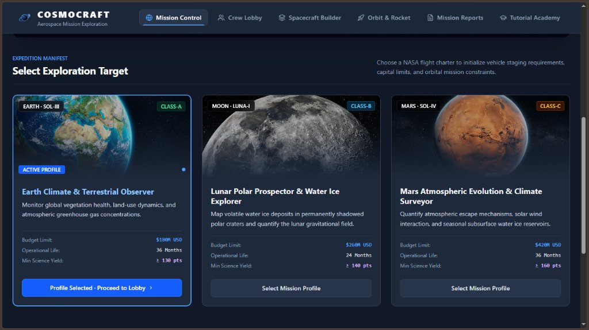

---

### 2. Spacecraft Builder & Subsystem Assembly
Assemble your probe in an interactive schematic workstation. View live visual component attachments, toggle between specialist role tabs, and balance power generation against active instrumentation draws.

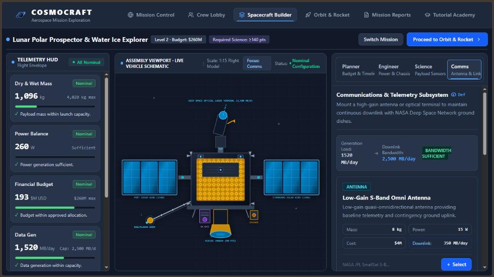

---

### 3. Real-Time Telemetry HUD & Constraint Tracking
Monitor the six primary mission resources. Immediate visual alerts flag power deficits, mass margin violations, solid-state recorder overflow risks, or agency budget overruns.

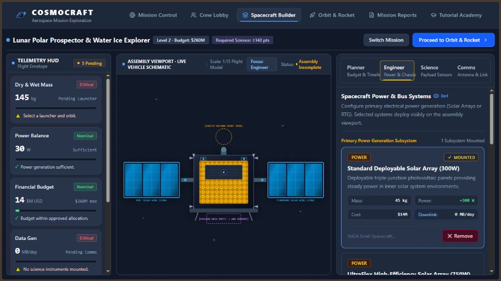

---

### 4. Orbit Selection, Launch Vehicles & Propulsion Staging
Select target deployment orbits and pair your spacecraft with commercial heavy-lift launchers (Falcon 9, Electron, Atlas V, Vulcan Centaur, or SLS). Adjust the propellant fuel slider to balance wet mass against orbital $\Delta v$ insertion requirements.

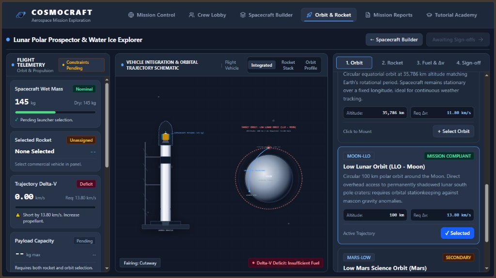

---

### 5. Multi-Role Flight Readiness Review (FRR)
Before ignition authorization is granted, all active specialists review system telemetry and execute digital sign-offs. If any engineering parameter fails, the engine prevents launch and provides diagnostic feedback.

| Constraint Failure Warning | All Systems Nominal – Go for Launch |
| :---: | :---: |
| 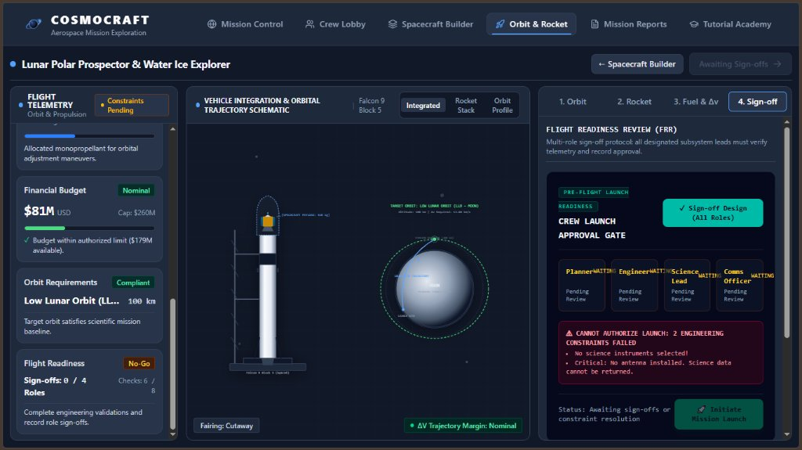 | 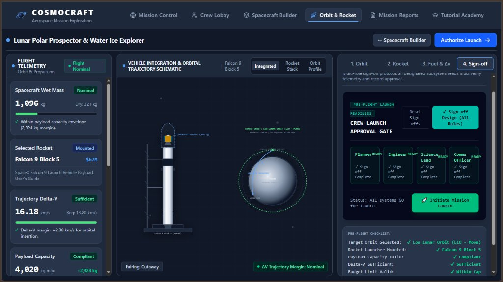 |
| *Identifies missing antennas or payload deficits prior to launch.* | *Full 4-role consensus unlocks the launch sequencer.* |

---

### 6. Mission Execution & Animated Flight Simulation
Watch the procedural 2D canvas visualizer execute launch operations through dynamic flight phases with real-time HUD telemetry readouts.

| Atmospheric Ascent & Transonic Staging | Deep Space Cruise |
| :---: | :---: |
| 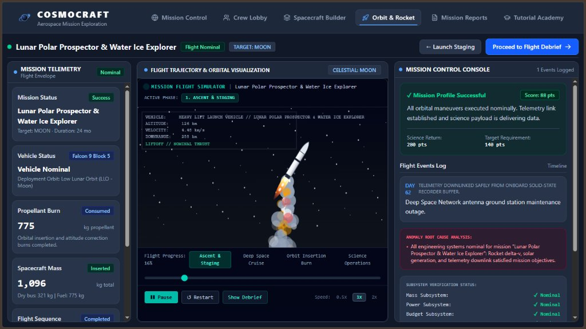 | 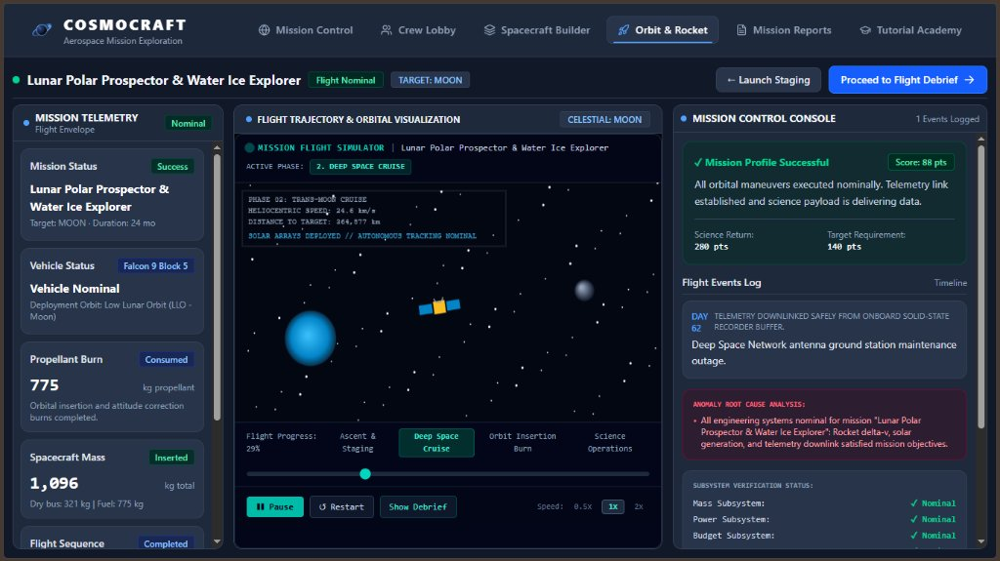 |
| *Gravity turn, Max-Q shockwaves, and fairing staging.* | *Interplanetary transit with solar wing deployment.* |

---

### 7. Orbital Insertion & Mission Debriefing
Monitor the retrograde capture burn into Low Lunar Orbit, review flight scoring across four engineering categories, inspect in-flight anomaly logs, and benchmark your probe against NASA historical missions.

| Orbital Insertion Burn | Mission Post-Flight Debrief |
| :---: | :---: |
| 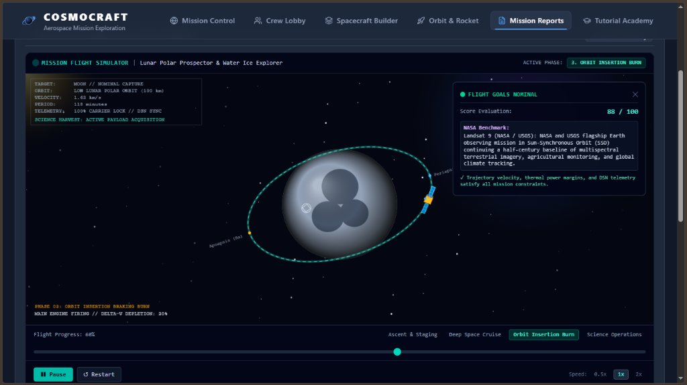 | 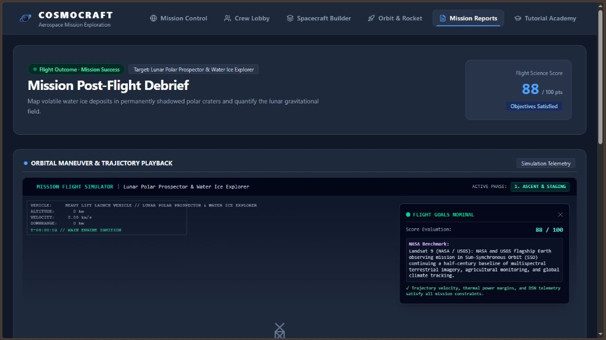 |
| *Retrograde braking burn establishing 100 km polar orbit.* | *Comprehensive debrief, flight score (88/100), and NASA benchmark.* |

---

### 8. Tutorial Flight Academy
Step-by-step interactive onboarding lessons designed for classrooms, beginner cadets, and competitive teams to master orbital mission formulation.

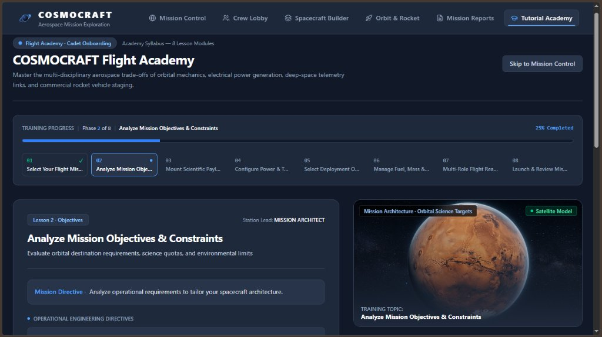

---

## How It Works

CosmoCraft guides players through an authentic 7-stage flight development lifecycle:

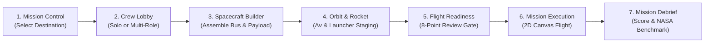

1. **Mission Selection (`/`):** The Mission Planner chooses an expedition target (Earth SSO, Moon LLO, or Mars Science Orbit), defining the baseline operational budget, target lifetime, and scientific goals.
2. **Crew Formation (`/lobby`):** Players choose between **Solo Architect Mode**, **Local Peer Mode** (via `BroadcastChannel`), or **Online Room Mode** (via Firebase Realtime Database) to claim specialist seats.
3. **Spacecraft Assembly (`/build`):**
   - **Lead Engineer:** Installs structural frames, solar arrays (Standard or UltraFlex), or nuclear MMRTG generators.
   - **Science Lead:** Selects instruments (imagers, spectrometers, radars, magnetometers) to fulfill mission science requirements.
   - **Comms Officer:** Mounts S-band, X-band, or optical laser terminals to guarantee ground downlink throughput.
4. **Trajectory & Staging (`/orbit-rocket`):** The crew selects deployment orbits, chooses an appropriately rated commercial launch vehicle, and adjusts onboard propellant mass to satisfy orbital $\Delta v$ margins.
5. **Flight Readiness Review:** The engine evaluates 8 automated engineering checks. All claimed roles must confirm approval. If any subsystem is modified, approvals automatically reset.
6. **Animated Flight Execution:** The mission launches into an interactive 2D simulation canvas detailing atmospheric ascent, transonic Max-Q, fairing separation, cruise, and orbital capture burns.
7. **Post-Flight Debrief (`/report`):** The crew inspects their final score (0–100 pts), reviews in-flight space weather events, and analyzes comparative telemetry against historical NASA missions.

---

## NASA Data & Scientific References

> [!NOTE]
> **Educational Disclaimer:** CosmoCraft is an educational simulation developed for the NASA Space Apps Challenge. It utilizes verified, preloaded scientific reference data and engineering approximations derived from published NASA technical documentation and mission user guides. It does not connect to live operational NASA telemetry feeds and is not an official NASA product.

The simulation draws its parameters from the following authoritative sources (cataloged in [`docs/CREDITS.md`](docs/CREDITS.md)):

### 1. Scientific Instruments (`src/data/instruments.json`)
- **HiRISE (High Resolution Imaging Science Experiment):** 65 kg mass, 60 W power, 0.3 m ground resolution. *Source: NASA Mars Reconnaissance Orbiter (MRO) / University of Arizona / JPL.*
- **CRISM (Compact Reconnaissance Imaging Spectrometer for Mars):** 33 kg mass, 45 W draw, 400 MB/day data. *Source: Johns Hopkins APL / NASA MRO.*
- **SAR & Radar Altimeter:** 75 kg mass, 110 W power, 600 MB/day. *Source: NASA Magellan & Cassini Radar Investigations / SRTM.*
- **Triaxial Fluxgate Magnetometer & Plasma Sensor:** 12 kg mass, 15 W power. *Source: NASA MAVEN Magnetometer / NASA Goddard Space Flight Center.*
- **Diviner Multispectral Thermal Radiometer:** 11 kg mass, 25 W power. *Source: NASA Lunar Reconnaissance Orbiter (LRO) / UCLA / JPL.*
- **LEND (Lunar Exploration Neutron Detector):** 25 kg mass, 30 W power. *Source: NASA LRO / NASA Lunar Prospector.*
- **CALIOP (Atmospheric Backscatter LIDAR):** 110 kg mass, 140 W power. *Source: NASA CALIPSO / NASA Langley Research Center.*
- **IUVS (Imaging Ultraviolet Spectrograph):** 16 kg mass, 20 W power. *Source: NASA MAVEN / LASP, University of Colorado Boulder.*
- **SHARAD (Shallow Subsurface Radar Sounder):** 40 kg mass, 80 W power. *Source: NASA / Agenzia Spaziale Italiana (ASI) MRO Investigation.*
- **CDA (Cosmic Dust Analyzer):** 17 kg mass, 18 W power. *Source: NASA / ESA Cassini Investigation / Max Planck Institute.*

### 2. Spacecraft Subsystems (`src/data/parts.json`)
- **Photovoltaic Power:** Deployable Triple-Junction PV (300 W) & UltraFlex Solar Arrays (750 W). *Source: NASA Small Spacecraft Technology & NASA InSight / Orion UltraFlex Programs.*
- **Radioisotope Generators:** Multi-Mission Radioisotope Thermoelectric Generators (MMRTG - 125 W) & Next-Gen Nuclear RTG (300 W). *Source: NASA Radioisotope Power Systems Program (Curiosity & Perseverance).*
- **Deep-Space Telemetry:** Low-Gain S-Band Omni, Medium-Gain Horn, High-Gain Cassegrain Dish, and Deep Space Optical Communications (DSOC) laser terminal. *Source: NASA DSN Telecommunications Handbook & NASA Psyche Mission.*
- **Bus Architecture:** Honeycomb Composite Primary Structure. *Source: NASA Systems Engineering Handbook (SP-2016-6105).*

### 3. Trajectory & Launch Vehicle Performance (`src/data/orbits.json`, `src/data/rockets.json`)
- **Orbital $\Delta v$ Benchmarks:** Low Earth Orbit (9.4 km/s), Sun-Synchronous Orbit (9.8 km/s), GTO (11.2 km/s), GEO (11.8 km/s), Low Lunar Orbit (13.8 km/s), and Low Mars Orbit (15.2 km/s). *Source: NASA General Mission Analysis Tool (GMAT) trajectory data.*
- **Launch Vehicle Lift Capacities:** Verified payload user guides for NASA Space Launch System (SLS Block 1 - ESD 30000), SpaceX Falcon 9 Block 5 (Rev 2, 2021), Rocket Lab Electron (v6.5, 2020), and United Launch Alliance Atlas V 551 & Vulcan Centaur VC6 (2023).

### 4. Historical Comparative Missions (`src/data/realMissions.json`)
Debrief telemetry correlates player designs against five benchmark missions:
- **Landsat 9:** NASA / USGS Sun-Synchronous terrestrial climate observer.
- **Lunar Reconnaissance Orbiter (LRO):** NASA polar lunar water ice prospector.
- **Mars Reconnaissance Orbiter (MRO):** NASA multi-instrument Martian orbiter.
- **MAVEN:** NASA upper atmospheric escape and solar wind surveyor.
- **Terra EOS AM-1:** Flagship multi-instrument Earth observing satellite.

---

## How the Simulation Works

The simulation engine (`src/engine/`) runs as a pure, deterministic validation pipeline:

### 1. The Eight Flight Readiness Checks

| Check ID | Validation Criteria | Example Diagnostic Message |
| :--- | :--- | :--- |
| **`mass`** | Wet spacecraft mass $\le$ rocket capacity to target orbit | `Mass ok (1,096 kg <= 4,020 kg)` or `Over mass by 245 kg` |
| **`power`** | Gross electrical generation $\ge$ active instrument draw | `Mars Solar Deficit (1/r² law): Sunlight is only 43% of Earth intensity.` |
| **`budget`** | Total development cost $\le$ mission financial cap | `Budget ok: $193M / $260M` or `Over budget by $18.5M` |
| **`data`** | At least one scientific instrument installed | `Science active: 1,520 MB/day generated.` |
| **`comms`** | Effective downlink bandwidth $\ge$ instrument data rate | `Downlink bottleneck: Instruments produce 1520 MB/day, exceeding antenna (750 MB/day).` |
| **`time`** | Selected operational duration $\ge$ required mission baseline | `Mission duration 24 months satisfies goal.` |
| **`launch`** | Launcher selected and launch capacity valid | `Launcher payload limit respected.` |
| **`orbit`** | Available orbital velocity $\Delta v \ge$ target trajectory demand | `Orbital insertion energy nominal (+2.38 km/s margin).` |

### 2. Applied Physical Approximations

- **Solar Distance Attenuation:** For Mars-bound missions, photovoltaic generation is scaled by the inverse-square law:
  $$\text{Irradiance Factor} = \frac{1}{r^2} = \frac{1}{1.524^2} \approx 0.43$$
  *(Radioisotope Thermoelectric Generators maintain 100% output regardless of solar distance).*
- **Deep-Space Telemetry Path Loss:** High-altitude and interplanetary orbits incur an empirical 30% link margin attenuation ($0.70\times$ effective throughput) inspired by the Friis transmission equation and Deep Space Network pass contention.
- **Onboard Rocket Propulsion:** Spacecraft velocity increment for orbital insertion is calculated using the Tsiolkovsky rocket equation:
  $$\Delta v = I_{sp} \cdot g_0 \cdot \ln\left(\frac{m_{\text{wet}}}{m_{\text{dry}}}\right)$$
  *(Modeled with hydrazine monopropellant: $I_{sp} = 310\text{ s}$, $g_0 = 9.81\text{ m/s}^2$).*

### 3. Flight Scoring Formula (0–100 Pts)

$$\text{Final Score} = \text{Score}_{\text{Science}} (45) + \text{Score}_{\text{Budget}} (25) + \text{Score}_{\text{Safety Margin}} (20) + \text{Bonus}_{\text{Teamwork}} (10)$$

---

## Technology Stack

### Frontend & Architecture
- **Framework:** React 19.3 & TypeScript ~7.0
- **Build Tooling:** Vite 8.3 & Rollup
- **Styling:** TailwindCSS 4.3 & Custom DeepSky Aerospace Theme
- **State Architecture:** Zustand 5.1 (Decoupled design and multi-role sync stores)
- **Routing:** React Router DOM 7.18
- **Graphics & Rendering:** Hardware-accelerated HTML5 Canvas 2D procedural rendering engine

### Multiplayer & Networking
- **Cloud Backend:** Firebase Realtime Database 13.3 & Anonymous Authentication
- **Local Fallback:** Browser `BroadcastChannel` API for zero-credential peer synchronization
- **Security:** Granular Firebase Security Rules (`database.rules.json`) enforcing client role exclusivity

### Verification & Testing
- **Test Runner:** Vitest 5.1
- **Test Coverage:** 98 unit and integration tests across data integrity, physics models, canvas renderers, and multiplayer concurrency

---

## System Architecture

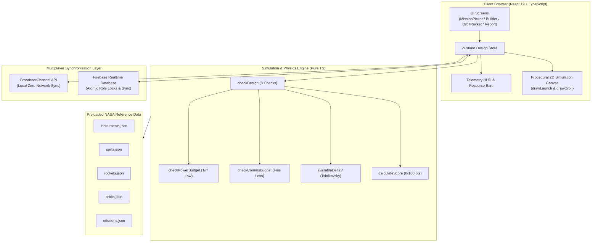

---

## Getting Started

### Prerequisites
- **Node.js:** v18.0.0 or higher
- **npm:** v9.0.0 or higher

### 1. Clone the Repository
```bash
git clone https://github.com/Div70-07/space_mission_game.git
cd space_mission_game
```

### 2. Install Dependencies
```bash
npm install
```

### 3. Configure Environment Variables (Optional)
The simulator includes a full zero-network fallback mode that runs offline without any configuration. To enable cloud-synchronized multiplayer rooms, create a `.env` file:
```bash
cp .env.example .env
```
Populate `.env` with your Firebase project credentials:
```env
VITE_FIREBASE_API_KEY=your_api_key
VITE_FIREBASE_AUTH_DOMAIN=your_project.firebaseapp.com
VITE_FIREBASE_DATABASE_URL=https://your_project-default-rtdb.firebaseio.com
VITE_FIREBASE_PROJECT_ID=your_project_id
```

### 4. Start Local Development Server
```bash
npm run dev
```
Navigate to `http://localhost:5173` in your browser.

### 5. Execute Test Suite
Verify simulation physics, GMAT delta-v calculations, and multiplayer state:
```bash
npm test
```
*(Runs all 98 Vitest unit and integration tests).*

### 6. Build for Production
```bash
npm run build
```
Generates optimized static assets in the `dist/` directory.

### 7. Preview Production Build
```bash
npm run preview
```
Serves the production build locally at `http://localhost:4173`.

---

## Project Structure

```
space-mission/
├── docs/                               # Documentation, testing guides & assets
│   ├── images/                         # Application preview screenshots
│   ├── CREDITS.md                      # Comprehensive data source attributions
│   ├── DEMO_SCRIPT.md                  # 90-second flight demonstration script
│   ├── SUBMISSION.md                   # NASA Space Apps Challenge submission summary
│   └── TEST_CHECKLIST.md               # Manual quality assurance protocol
├── public/                             # Public static assets & vector diagrams
│   ├── images/                         # Custom SVG diagrams & AI concept art
│   ├── favicon.svg                     # Custom aerospace vector favicon
│   └── icons.svg                       # Inline SVG UI icon spritesheet
├── src/
│   ├── content/                        # Tutorial curriculum, tooltips & debrief copy
│   ├── data/                           # Preloaded NASA-referenced datasets (JSON)
│   │   ├── instruments.json            # 10 scientific payloads with mass/power/data
│   │   ├── parts.json                  # Bus components, solar panels, and antennas
│   │   ├── rockets.json                # Commercial and NASA launch vehicle capacities
│   │   ├── orbits.json                 # Target orbits & GMAT reference delta-V
│   │   ├── missions.json               # Expedition profiles and constraints
│   │   ├── events.json                 # Randomized in-flight space weather anomalies
│   │   └── realMissions.json           # Historical NASA benchmark missions
│   ├── engine/                         # Pure TypeScript aerospace simulation engine
│   │   ├── checkDesign.ts              # 8-point Flight Readiness Review validator
│   │   ├── comms.ts                    # Deep-space path loss & downlink calculator
│   │   ├── deltaV.ts                   # Tsiolkovsky propulsion & GMAT orbit delta-V
│   │   ├── power.ts                    # Electrical power balance & 1/r² solar law
│   │   ├── scoring.ts                  # Multi-factor flight evaluation algorithm
│   │   ├── runMission.ts               # Simulation orchestrator & event generator
│   │   └── report.ts                   # Diagnostic debrief generator
│   ├── scene/                          # Procedural 2D flight animation engine
│   │   ├── drawLaunch.ts               # Rocket ascent, shock diamonds & Max-Q staging
│   │   ├── drawOrbit.ts                # Planetary cruise & orbital capture maneuvers
│   │   └── MissionScene.tsx            # HTML5 Canvas React lifecycle wrapper
│   ├── screens/                        # UI screens & modular workstation components
│   │   ├── MissionPicker.tsx           # Destination selection & flight manifests
│   │   ├── Builder.tsx                 # Spacecraft assembly workstation
│   │   ├── OrbitRocket.tsx             # Trajectory, launcher staging & FRR approvals
│   │   ├── Report.tsx                  # Post-flight debrief & telemetry report
│   │   ├── Tutorial.tsx                # Interactive 8-step Flight Academy
│   │   └── components/                 # Telemetry HUD, Resource Bars & Assembly View
│   ├── team/                           # Real-time multi-role collaboration system
│   │   ├── firebaseBackend.ts          # Cloud database synchronization
│   │   ├── localBackend.ts             # BroadcastChannel cross-tab synchronization
│   │   ├── roles.ts                    # Workstation access policy & role definitions
│   │   └── ApproveGate.tsx             # Multi-seat launch sign-off component
│   └── shared/                         # Core domain models, interfaces & Zustand stores
├── database.rules.json                 # Granular Firebase Realtime Database security rules
├── index.html                          # HTML5 application entry point
├── package.json                        # Project dependencies and test scripts
├── tsconfig.json                       # TypeScript compiler configuration
└── vite.config.ts                      # Vite build pipeline and path aliases
```

---

## Team & Roles

**NASA Space Apps Challenge 2026**  
**Team Name:** Ad Astra Per Aspra  

| Specialist | Domain Responsibility |
| :--- | :--- |
| **Mission Lead / Architecture Integrator** | Project architecture, system integration, routing, and deployment. |
| **Physics Engine & Scoring Lead** | Mathematical modeling (`src/engine/`): Tsiolkovsky equations, GMAT delta-v, solar attenuation, and scoring. |
| **User Experience & Telemetry Engineer** | Interface engineering (`src/screens/`): DeepSky design system, telemetry HUD, and interactive workstations. |
| **Multiplayer Systems Architect** | Real-time synchronization (`src/team/`): Firebase transactions, BroadcastChannel, and role-based access control. |
| **Data & Narrative Specialist** | NASA scientific datasets (`src/data/`), flight academy curriculum, vector illustrations, and debrief narratives. |

---

## Acknowledgements & References

- **NASA Space Apps Challenge 2026:** For inspiring global collaborative solutions to real-world aerospace challenges.
- **NASA Jet Propulsion Laboratory (JPL) & University of Arizona:** For open documentation on the Mars Reconnaissance Orbiter (HiRISE, CRISM, SHARAD).
- **NASA Goddard Space Flight Center (GSFC):** For public documentation regarding the Lunar Reconnaissance Orbiter (Diviner, LEND) and MAVEN planetary aeronomy.
- **NASA Langley Research Center:** For CALIPSO satellite lidar data and technical briefs.
- **NASA Headquarters & Exploration Systems Development:** For the NASA Systems Engineering Handbook (SP-2016-6105) and SLS Mission Planner's Guide (ESD 30000).
- **European Space Agency (ESA) & Italian Space Agency (ASI):** For collaborative instrument specifications on Cassini-Huygens and MRO.
- **Open Source Community:** React, Vite, TailwindCSS, Zustand, Vitest, and Firebase for powering high-performance modern web development.

---

## License

This project was developed for the **NASA Space Apps Challenge 2026**. 
- Custom SVG diagrams, illustrations, and source code are provided under the [MIT License](https://opensource.org/licenses/MIT).
- Spacecraft and instrument technical parameters adhere to public open-access NASA and partner agency documentation.
- See [`docs/CREDITS.md`](docs/CREDITS.md) for full individual asset attributions.
